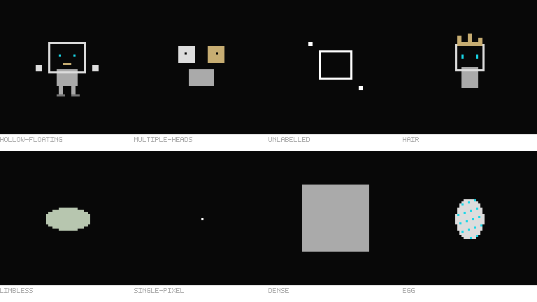
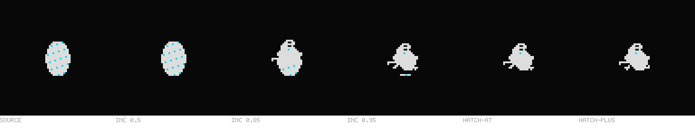

# Small edge-case regression gallery

One fixed raw seed (`life-v7-genome-01`), eight sources,70 rendered conditions and8 authored source images. No runtime or frozen audit-tool changes. All actual images were inspected by an agent; human review remains pending. These observations do not increase the main proof or population denominators.

[Interactive gallery](index.html) · [Actual-image receipt](visual-review.json) · [Frozen sources/hashes/accounting](manifest.json) · [Incubation supplement](incubation-supplement.json)

|Fixture|Rendered views inspected|Feature visibility0–3|Expected gaps0–3|Motion continuity0–3|Actual observation|
|---|---:|---:|---:|---:|---|
|hollow-floating|12|2|2|2|Both cyan eyes and the gold mouth remain visible inside an actual black head cavity at all four milestones. The outline changes shape without becoming an opaque facial decal.|
|multiple-heads|12|2|2|2|The two solid head colors and one dark facial mark in each remain independently recognizable at0/30/75/120. They reorganize around the trunk instead of being collapsed into one pair of eyes.|
|unlabelled|4|N/A|2|N/A|The full ring and two detached bright fragments are exact at birth. Later freeform tissue opens into thin curves and several irregular fragments; the source was not rejected.|
|hair|12|2|2|2|Two cyan eyes stay visible inside the hollow square/tilted head. Gold hair remains attached to the head rim at all four ages.|
|limbless|12|N/A|N/A|2|The pale green source remains featureless: no eyes or mouth were visually invented. The body develops multiple lobes and a more irregular contour.|
|single-pixel|4|N/A|N/A|N/A|Birth is exactly one visible white pixel. Teen and adult are small nonempty clusters.|
|dense|4|N/A|N/A|N/A|The exact birth is a solid gray square because all15 full masks overlap in one color. Developed outputs remain bounded filled silhouettes.|
|egg|10|2|N/A|N/A|The authored spotted egg is exact at time zero. A different small gray/cyan hatchling is visible before the semantic hatch boundary and later grows into distinct larger forms.|

N/A means the drawing does not support that expectation, not a passing score. A score2 is minimum adequate readability, not a broad pet-quality claim. All8/8 authored sources match exact idle birth artwork. The original67/67 frames are finite and in bounds; the three additional incubation images are separately recorded.

The hollow faces keep visible eye marks and black interiors. Floating hands remain visible, though their gaps can become tight. Both differently colored heads remain distinguishable. Rooted hair remains attached but can look like a rigid crown. The limbless body slithers without invented facial features.

The arbitrary unlabelled drawing can become ragged disconnected curves, and the one-pixel elder becomes a solid rectangular slab. These quality weaknesses remain visible rather than being hidden behind source-ID bookkeeping. The dense fixture deliberately paints15 full same-color masks on top of one another, so readable authored facial detail is not present to preserve.

The egg produces a different hatchling. Its8.74/8.75/8.76-day boundary is almost visually continuous; the supplement shows emergence earlier in incubation. Crack lines/shards are comparatively weak.

No physical iPhone, signed-widget, human-acceptance or population-diversity claim follows from this small gallery.
