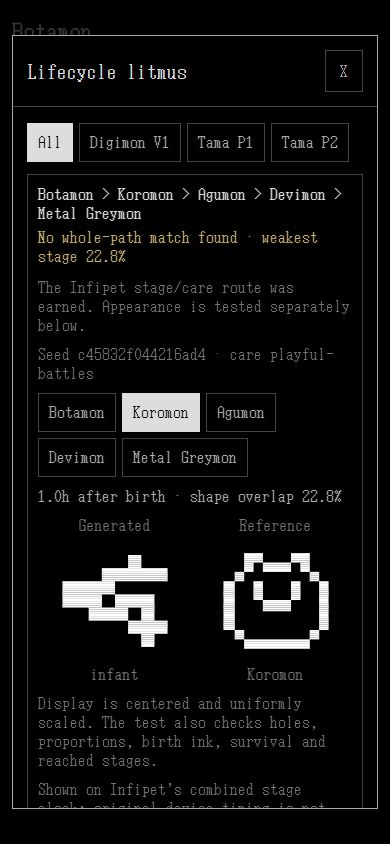

# Retro lifecycle results / life-v9

The reference library and causal lifecycle test are implemented. **Near-exact full lifecycle reproduction is not demonstrated.** Every generated form comes from its ordinary starting drawing, seed and recorded care; reference artwork remains outside the renderer.

## Final measured run

[Cohort 002 contact sheets](cohort-002/index.html), [summary](cohort-002/summary.json), [manifest](cohort-002/manifest.json) and [frozen reference catalog](cohort-002/reference-catalog.json) retain the actual inputs and results.

| Measure | Result |
| --- | --- |
| Editable reference drawings | **36**: 14 Digital Monster V1, 11 P1, 11 provisional P2 |
| Root-to-last-listed reference paths | **25**: 10 V1, 9 P1, 6 P2 |
| Shared neutral seeds / generic care routines | **4 / 15** |
| Path comparisons | **1,500**, reusing **180** unique source/seed/care recipes |
| Current Infipet gameplay routes earned | **25 / 25**; all 10 V1 branch-slot paths earned |
| Scored reference forms | **25**; 11 P2 forms remain edition-unverified |
| Whole-path appearance results | **19 failed, 6 unscored** |
| Near-exact machine candidates / visually accepted matches | **0 / 0** |
| Weakest-stage ink IoU among scored selected recipes | **14.13–27.65%** |
| Frozen witness replays verified | **25**, published as 18 deduplicated app recipes |

Gameplay eligibility means the combined Infipet engine reached the required stages alive, retained source/face material and earned the V1 branch slots where available. P1/P2 original care predicates and timing are not certified by that result. The P2 source images are usable drawings, but an observed community atlas with unresolved original-versus-rerelease provenance cannot certify original-P2 morphology.

The search selects complete gameplay eligibility before ranking worst-stage and mean similarity. Its neutral seed cohort and routines are shared across reference targets. It records actual commands, including training entry/cancellation, rejected care and ordinary battle outcomes. It supplies no stage counters, winning results, target masks or desired character names to the simulation.

## What the images show

The exact birth drawing is retained. The first filled-to-outlined transformation already fails: authored interior pigment remains filled, and later facial contrast does not acquire the reference structure. Subsequent body plans and LCD markings also differ substantially. The inherited supports, manipulators, tails and bounded facial growth add ordinary anatomical vocabulary, but do not establish reference coverage.

Developer visual inspection covered the complete Botamon–Greymon–Metal Greymon, Babytchi–Mametchi and Shirobabytchi–Mimitchi sheets. The P2 sheet is explicitly unscored. No image was accepted as a near-exact lifecycle. The source extractor separately inspected the complete 36-form collage. Phone browser checks verified the gallery, search, edition labels, source loading/reload retention, and checksum-matched frames at birth, 1 hour and 193 hours without horizontal overflow.



Source identity is not a complete appearance score. A preserved face and correct gameplay branch cannot compensate for an unrelated silhouette or a failed intermediate stage. [Grammar limits](../grammar-limits.md) identify general material/surface expression as the earliest concrete missing operation. Target-specific cutouts or stored later sprites would invalidate this test.

## Reproducibility

The run pins life-v9, gameplay 2, needs rules 2, the exact needs catalog, animal catalog/affinity versions and morphogenesis-v1. Its engine-source SHA-256 is `6d5f7e8e78b7061516ce56e51d1143a103eb95c5151d3dec1b260aea89a3e6a2`, covering 36 runtime/validation source files, including care and source composition. The manifest lists those files and the separately hashed catalog, cases, images, HTML and witnesses.

Birth checks compare raw flattened coordinates and colors after the fixed canvas-to-world translation. Later similarity permits only translation and uniform scale; topology, proportions, survival, source/face continuity and stage/branch eligibility remain independent gates. Browser frames are regenerated from concrete care recipes and checked against capture checksums before a measured score is shown. Archive SHA-256 verification is authoritative.

```powershell
node node_modules/tsx/dist/cli.mjs tools/retro-audit/run.ts verify --out docs/audits/life-v9/retro/cohort-002
```

A failed bounded search does not prove that no possible seed exists. The current evidence also does not prove that a successful one exists. This corpus supplies a repeatable test for improving shared operators. Cases cover a root through its last listed form, not every mortality, animation or optional adult-retained ending. Earlier cohort 001 remains a historical intermediate run and is not the current verified engine baseline.
